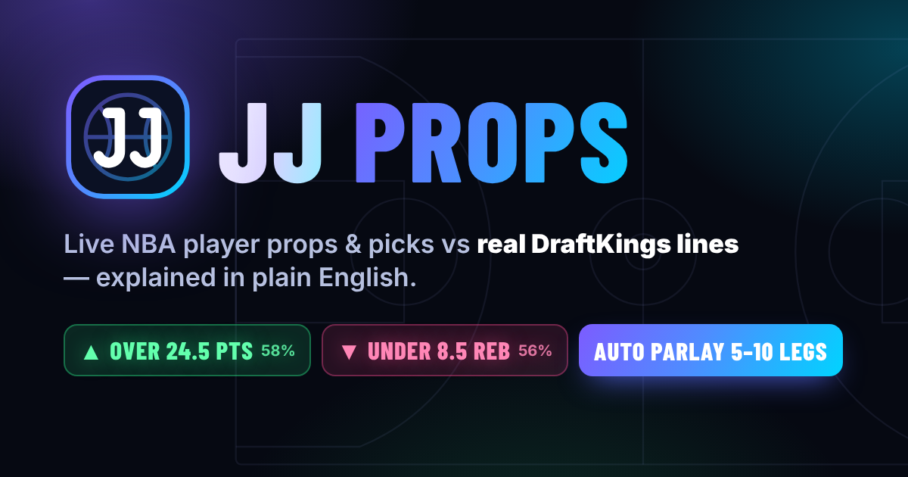

# JJ Props — NBA Player Props & Picks

**Live site: https://drunksalmy.github.io/jj-props/**

JJ Props predicts NBA player props (points, rebounds, assists, 3-pointers, and the combos PR = points + rebounds, PA = points + assists, PRA) and game bets (winner, spread, total), compares them with **real DraftKings lines**, and explains every over/under in plain English. It updates live while games are on.

## What's inside

- **Top Picks** — the day's best plays, each with the chance it wins, what it needs to win to be worth betting, hit rates and the reasons why.
- **Auto Parlay** — pick 5–10 legs and a style (*Best value* or *Safest*); JJ Props fills the slip with the best legs from today's DraftKings lines, one per player and spread across games, and shows the chance all legs hit, the payout on $10 and the expected return. Swap any leg or copy the slip.
- **Games** — win chance, winning margin vs the spread, total points, injuries, and a **live lead tracker** (current lead, biggest lead, lead changes, ties, scoring runs).
- **Player Props** — every rotation player vs the DraftKings line (PTS, REB, AST, PR, PA, PRA, 3PM), with a line box to type another sportsbook's line. Combo props show how the projection adds up (e.g. 18.5 PR = 12.4 points + 6.1 rebounds).
- **How it works** — betting terms in plain English.

## How the numbers work (short version)

Projections come from each player's minutes and per-minute production, adjusted for the matchup, home court, back-to-backs and injured teammates. The chance of an over/under comes from the player's own game-to-game spread. Because sportsbooks are usually close to right, every chance is blended with DraftKings' own odds (more so early in the season and for players on new teams), so the app only calls a pick when the model clearly disagrees with the book.

## Data

All data comes from ESPN's public NBA feed (the one espn.com uses): scores, box scores, play-by-play, injuries, standings, game logs, and DraftKings game and player-prop lines. It isn't an official developer API and could change.

## Run it yourself

It's a static site — no build step, no server code. Open `index.html` in a browser, or host the folder anywhere (GitHub Pages, Netlify, …).

Tests (Node.js): `node tests/unit.test.js`, `node tests/calibration.test.js`, and with Playwright installed `node tests/ui.test.js`.

## Please note

Predictions are estimates, not guarantees. For entertainment and learning only · 21+ · bet responsibly. Not affiliated with the NBA, ESPN or DraftKings. Fonts: Inter and Barlow Condensed (SIL Open Font License, see `fonts/`).
